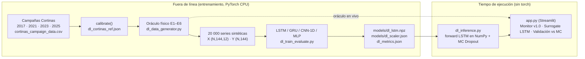
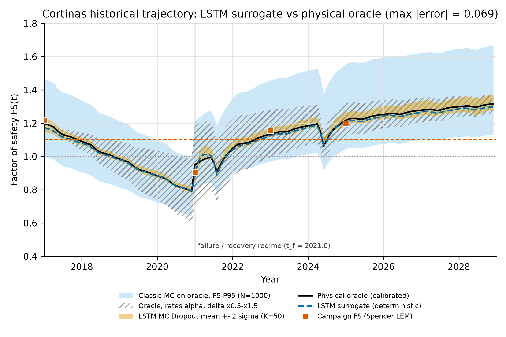
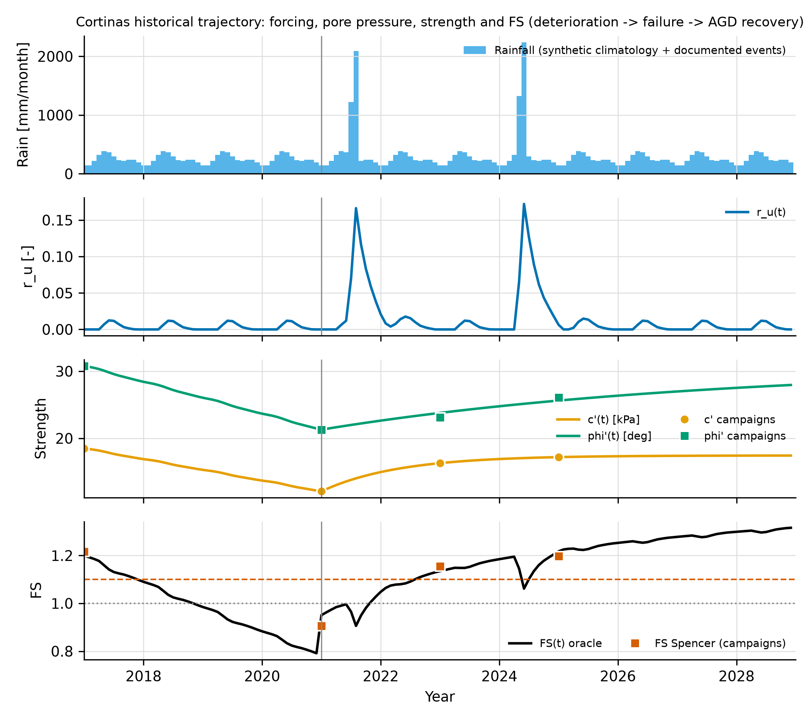
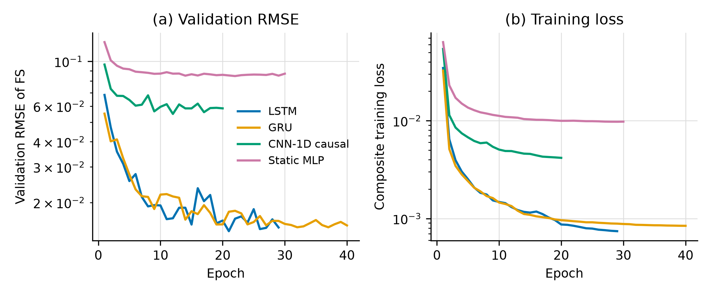
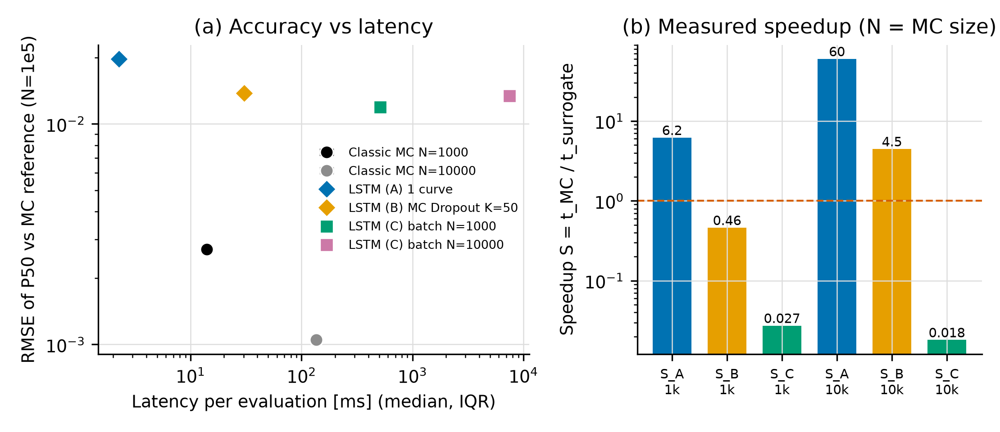
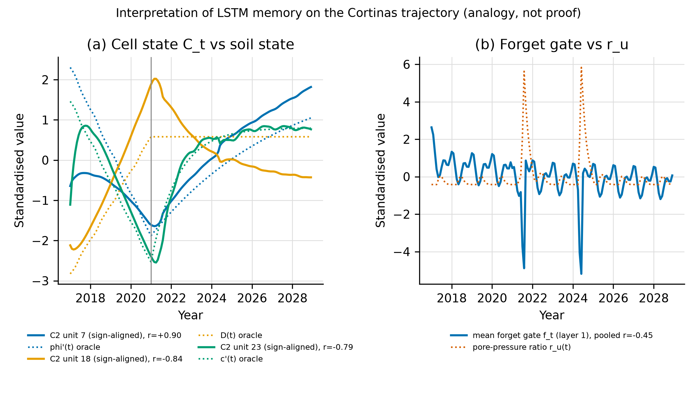

# AGD-Sentinel 2.0: surrogate profundo guiado por la física para la estabilidad temporal de taludes

AGD-Sentinel es un marco abierto para proyectar en el tiempo el Factor de Seguridad (FS) de taludes
infinitos sometidos a degradación geotécnica (régimen AGD: deterioro, falla y recuperación parcial).
La versión 1.0 combinó equilibrio límite pseudo-estático (LEM), leyes lineales de degradación de
c' y φ', propagación Monte Carlo y regresión polinomial. **La versión 2.0 añade un surrogate de
aprendizaje profundo (LSTM secuencia a secuencia) entrenado sobre un oráculo físico calibrado con
las campañas del deslizamiento de Cortinas (Toledo, Norte de Santander)**, con incertidumbre por
MC Dropout e inferencia en NumPy puro dentro de la aplicación, sin framework de deep learning en
tiempo de ejecución.

Proyecto del curso *Aprendizaje Profundo*, Universidad Industrial de Santander (UIS).
Autores de la versión 2.0: **Julián David Baena, Isabella Plata y Juan José Rangel Camacho**.

---

## Contenido

1. [Arquitectura 2.0](#1-arquitectura-20)
2. [Flujo del surrogate guiado por la física](#2-flujo-del-surrogate-guiado-por-la-física)
3. [Mapa de scripts y archivos](#3-mapa-de-scripts-y-archivos)
4. [Resultados](#4-resultados)
5. [Limitaciones y supuestos](#5-limitaciones-y-supuestos)
6. [Reproducción](#6-reproducción)
7. [Despliegue: Cloud, Local y Offline](#7-despliegue-cloud-local-y-offline)
8. [Base v1.0 (manuscrito)](#8-base-v10-manuscrito)
9. [Aviso, cita y licencia](#9-aviso-cita-y-licencia)

---

## 1. Arquitectura 2.0



- **Pestaña "Monitor v1.0"**: el tablero original, idéntico a la versión 1.0 (mismos controles, misma
  lógica y mismo ajuste polinomial).
- **Pestaña "Surrogate LSTM"**: proyección FS(t) de 2017.0 a 2028.92 (144 pasos mensuales) con banda
  μ ± 2σ por MC Dropout, el oráculo físico superpuesto, los FS de campaña (Spencer) y cinco indicadores:
  FS final, cruce FS = 1.1 con banda, error relativo frente al oráculo, latencia y speedup.
- **Pestaña "Validación vs MC"**: Monte Carlo paramétrico (esquema `master_run`) sobre el oráculo y sobre
  el LSTM en lote, con las mismas muestras; compara P5–P50–P95 de FS(t) y el histograma del año de cruce.
- Si `models/` no existe, la aplicación avisa y muestra solo el oráculo físico: nunca se rompe.

Decisión de diseño clave: **PyTorch solo se usa para entrenar**. Los pesos del LSTM se exportan a
`models/dl_lstm.npz` (219 kB, `allow_pickle=False`) y la aplicación reproduce la red en NumPy
(paridad NumPy–PyTorch 3.6·10⁻⁷). Así el paquete offline no crece y la aplicación arranca con las
mismas dependencias que la versión 1.0.

## 2. Flujo del surrogate guiado por la física

**Paso 1: oráculo físico calibrado** (`dl_data_generator.py`). Es el motor de talud infinito de la v1.0
extendido con forzante hidroclimático, reloj de daño y recuperación posterior a la falla:

| Ecuación | Contenido |
|---|---|
| E1 | FS = [c + (γ z_e cos²β (1 − r_u) − k_h γ z_e sinβ cosβ) tanφ] / [γ z_e sinβ cosβ + k_h γ z_e cos²β]. Con r_u = 0, k_h = 0 y z_e = z es la fórmula v1.0. |
| E2 | Lluvia mensual normalizada p̃_k = P_k / P̄ (P̄ = 250 mm/mes): estacionalidad bimodal × factor interanual lognormal × ruido Gamma(4, 1/4) + eventos extremos (Poisson(3) por serie, 1500–3200 mm en 2 meses). 10 % de las series sin forzante (p̃ ≡ 1). |
| E3 | Agua antecedente W_k = λ W_{k−1} + (1 − λ) p̃_k, λ = exp(−Δt/τ_d), τ_d = 0.25 a; r_u = clip(r_1 (W_k − 1), 0, 0.5). |
| E4 | Reloj de daño D_k = D_{k−1} + Δt [(1 − η) + η p̃_{k−1}], η = 0.6; c = max(c0 − α D, 1), φ = max(φ0 − δ D, 5). Con p̃ ≡ 1, D = t y se recupera la ley lineal v1.0. |
| E5 | Recuperación tras la falla (t ≥ t_f, daño congelado): X(t) = X_∞ − (X_∞ − X_f) exp(−κ_r (t − t_f)/τ_X) para X ∈ {c, φ}; z_e = ζ z. |
| E6 | t_crit = primer cruce descendente de FS = 1.1 con interpolación lineal (misma regla que `cross()` de la v1.0). |

Con el forzante apagado y sin recuperación, el oráculo reproduce la v1.0 a precisión de máquina
(|ΔFS| = 1.6·10⁻¹⁵ frente a una copia literal del motor de `master_run.py`).

**Paso 2: calibración** (`calibrate()`, constantes congeladas en `dl_cortinas_ref.json`). Sobre la
trayectoria "Cortinas histórica" (nominales v1.0, k_h = 0, falla en t_f = 2021.0, climatología y los
dos eventos documentados: 2790.5 mm en jul–ago 2021 y 2803.9 mm en may–jun 2024):

| Constante | Valor | Ajustada con |
|---|---|---|
| ρ_c (fracción de c0 recuperable) | 0.943 | c'(2023) = 16.3 y c'(2025) = 17.2 kPa (exacto) |
| τ_c (tiempo de recuperación de c') | 1.298 años | ídem |
| τ_φ (tiempo de recuperación de φ') | 6.573 años | φ'(2023) = 23.1°, φ'(2025) = 26.1° (mínimos cuadrados) |
| ζ (profundidad efectiva post-falla) | 0.397 → z_e = 5.16 m | FS Spencer 2023 = 1.155 y 2025 = 1.198 (mínimos cuadrados) |
| r_1 (sensibilidad de r_u a la lluvia) | 0.0556 | FS mínimo jul–sep 2021 = 0.906 (raíz) |

| Verificación (no usada para calibrar) | Oráculo | Referencia |
|---|---|---|
| FS(2017) | 1.200 | 1.216 (Spencer) |
| FS justo después de la falla (2021.0⁺) | 0.951 | ≈ 0.95 |
| FS mínimo may–jul 2024 (lluvia equivalente a 2021) | 1.062 | > 1.0: no hay falla (la "paradoja 2021 vs 2024" queda reproducida) |
| Cruces nominales v1.0 (FS = 1.1 / 1.0) | 2017.91 / 2018.85 | 2017.9 / 2018.9 |

**Paso 3: tensores** (`data/dl_dataset.npz`, regenerable y fuera de Git, semilla 42). N = 20 000 series
con el muestreo de Rosenblatt de la v1.0 (c0 normal, φ0 | c0 con ρ = −0.62; γ, z, β, α, δ uniformes),
más k_h (50 % de las series con k_h = 0, resto U(0, 0.30)), κ_r ~ U(0.5, 1.5) y régimen B de recuperación
con probabilidad 0.5 (t_f ~ U(2.5, 7) años, ζ ~ U(0.30, 0.55)). División por serie 70/15/15
(14 000 / 3 000 / 3 000).

- **X** con forma **(batch, timesteps, features) = (N, 144, 12)**, features por paso en este orden:
  `[τ = t/12, log1p(p̃), rec, z_e, c0, φ0, γ, β, α, δ, k_h, κ_r]`. Estandarización z-score con media y
  desviación del conjunto de entrenamiento en los índices 1 y 3–11 (`models/dl_scaler.json`); τ y rec
  quedan sin escalar.
- **Y** = FS(t) del oráculo, forma (N, 144), sin escalar. Auxiliares: t_crit, `cross`, c, φ, r_u, D.

**Paso 4: LSTM** (`dl_train_evaluate.py`): `LSTM(12→64) → LayerNorm → Dropout(0.10) → LSTM(64→64) →
LayerNorm → Dropout(0.10) → Linear(64→32) → ReLU → Linear(32→1) → softplus = FS(t)`, más una cabeza
auxiliar `Linear(64→1) + sigmoid` sobre h_T que estima t_crit/12. 55 682 parámetros. Pérdida compuesta:
MSE + 2.0·(MSE ponderado en la zona FS ≈ 1.1) + 0.1·(penalización de subidas no físicas durante el
deterioro) + 0.05·SmoothL1(t_crit). AdamW (lr 2·10⁻³, wd 10⁻⁴), lote 256, recorte de gradiente 1.0,
ReduceLROnPlateau y parada temprana (paciencia 8) con restauración del mejor estado.

**Paso 5: inferencia NumPy en la app** (`dl_inference.py`): forward exacto con el orden de compuertas
(i, f, g, o), exposición de los estados de celda C_t y de las compuertas, y MC Dropout con K pasadas
estocásticas en un solo lote (μ, σ, μ ± 2σ, P5–P95).

## 3. Mapa de scripts y archivos

| Archivo | Función | Requiere torch |
|---|---|---|
| `dl_data_generator.py` | Oráculo E1–E6, lluvia sintética, muestreo, `calibrate()`, dataset y `--check` (paridad con v1.0 y calibración) | No |
| `dl_train_evaluate.py` | Entrena LSTM, GRU, CNN-1D causal y MLP estática; métricas, MC Dropout, benchmark y exportación de pesos | Sí |
| `dl_inference.py` | Forward del LSTM en NumPy puro, MC Dropout, estados internos, carga tolerante a fallos | No |
| `dl_generate_figures.py` | Las cinco figuras `fig_dl_*.png` (300 DPI, paleta Okabe–Ito apta para daltonismo) | No |
| `app.py` | Aplicación Streamlit con las tres pestañas | No |
| `dl_cortinas_ref.json` | Constantes calibradas, residuales y trayectorias de referencia (nominal v1.0 y Cortinas histórica) | — |
| `dl_metrics.json` | Todas las métricas, el benchmark y el hardware de medición | — |
| `dl_training_log.csv` | Pérdida de entrenamiento y RMSE de validación por época y modelo | — |
| `models/dl_lstm.npz`, `models/dl_scaler.json` | Pesos de ejecución del LSTM y estandarización | — |
| `models/dl_{lstm,gru,cnn,mlp}.pt` | Pesos de PyTorch de respaldo para reevaluar (`--eval-only`) | — |
| `requirements.txt` | Dependencias de ejecución (aplicación e inferencia), sin torch | — |
| `requirements-train.txt` | Dependencias de entrenamiento (incluye torch CPU) | — |
| `run_AGD_Sentinel.bat` | Lanzador Windows (entorno portátil `motor_python` o `.venv` local) | — |

Opciones útiles: `dl_data_generator.py --check | --n | --seed`; `dl_train_evaluate.py --models lstm,gru
--eval-only --quick --batch 512 --lr 3e-3`.

## 4. Resultados

Todas las cifras proceden de `dl_metrics.json` (conjunto de prueba: 3 000 series no vistas × 144 pasos).
**Las métricas miden el ajuste al oráculo físico, no a observaciones de campo** (solo existen cuatro
campañas).

### 4.1 Comparación de modelos (prueba)

| Modelo | Parámetros | R² | RMSE | MAE | RMSE zona \|FS−1.1\|<0.1 | Δt_crit mediana / MAE (años) | Violaciones de monotonía | Máx. \|error\| Cortinas |
|---|---|---|---|---|---|---|---|---|
| **LSTM** | 55 682 | **0.9983** | **0.0145** | **0.0105** | **0.0163** | 0.072 / 0.104 | **0.94 %** | 0.069 (0.029 sin el paso de falla) |
| GRU | 42 305 | 0.9982 | 0.0151 | 0.0114 | 0.0189 | 0.066 / **0.097** | 1.23 % | **0.027** |
| CNN-1D causal | 41 537 | 0.9749 | 0.0558 | 0.0381 | 0.0465 | **0.053** / 0.120 | 11.28 % | 0.101 |
| MLP estática | 34 817 | 0.9411 | 0.0854 | 0.0568 | 0.0683 | 0.122 / 0.216 | 8.69 % | 0.139 |

Δt_crit se calcula sobre los 1 461 cruces interiores de prueba (0 < t_crit < 12 años), a partir de la
curva predicha. La exactitud de `cross` es 1.000 en los cuatro modelos, pero es trivial: el 100 % de las
series cruza FS = 1.1 y el 50.7 % ya parte de FS_0 ≤ 1.1.

Por régimen (RMSE / R²):

| Modelo | Régimen A (deterioro continuo, 1 531 series) | Régimen B (falla + recuperación, 1 469 series) |
|---|---|---|
| LSTM | 0.0127 / 0.9985 | **0.0161 / 0.9966** |
| GRU | **0.0119 / 0.9986** | 0.0178 / 0.9958 |
| CNN-1D | 0.0414 / 0.9836 | 0.0677 / 0.9394 |
| MLP | 0.0497 / 0.9763 | 0.1111 / 0.8368 |

Lectura: los modelos con memoria recurrente superan con amplitud a la MLP sin memoria (RMSE 5.9 veces
menor) y a la CNN de campo receptivo finito (31 meses). El LSTM gana en error global, zona crítica,
régimen B y monotonía; la GRU queda muy cerca y es mejor en el régimen A, en Δt_crit y en Cortinas.

### 4.2 Incertidumbre (MC Dropout, K = 50, prueba)

| Métrica | Valor |
|---|---|
| PICP95 (fracción de puntos dentro de μ ± 2σ) | 98.0 % |
| Cobertura P5–P95 | 94.4 % |
| σ media | 0.016 |
| RMSE de la media μ | 0.0135 |

La banda describe la incertidumbre del modelo (epistémica), no la de los parámetros del suelo; esta
última se propaga con Monte Carlo en la pestaña "Validación vs MC".

### 4.3 Latencia y speedup

Protocolo: misma máquina, CPU, `perf_counter`, 5 calentamientos + 30 repeticiones, mediana
(AMD Ryzen de 32 hilos, Windows 11, Python 3.11.9, NumPy 2.4.6). MC clásico = esquema `master_run`
(semilla 42, ρ = −0.62) sobre el oráculo vectorizado, flujo completo (muestreo + matriz FS N × 144 +
percentiles + t_crit). Precisión = RMSE del P50 frente a un MC de referencia con N = 10⁵.

| Configuración | Mediana (ms) | RMSE P50 vs referencia | Speedup S = t_MC / t |
|---|---|---|---|
| MC clásico, N = 1 000 | 13.95 | 0.0027 | — |
| MC clásico, N = 10 000 | 135.2 | 0.0010 | — |
| (A) LSTM, 1 curva determinista | 2.25 | 0.0197 | 6.2 (vs N = 1k) · 60.0 (vs N = 10k) |
| (B) LSTM, MC Dropout K = 50 | 30.3 | 0.0138 | 0.46 · 4.5 |
| (C) LSTM en lote, N = 1 000 | 510 | 0.0119 | 0.027 |
| (C) LSTM en lote, N = 10 000 | 7 470 | 0.0134 | 0.018 |

**Lectura honesta.** El oráculo de esta versión es analítico (talud infinito) y está vectorizado en NumPy:
evaluar 10 000 trayectorias de 144 meses cuesta ≈ 0.1 s. En ese escenario el LSTM **no** acelera el
Monte Carlo paramétrico en lote (S_C ≈ 0.02–0.03): una recurrencia de dos capas de 64 unidades por
144 pasos cuesta más que una fórmula cerrada. Los speedups S_A y S_B comparan una sola curva (o una
curva con banda de modelo) contra una distribución completa, por lo que no son una comparación de igual
a igual. El valor del surrogate está en:

1. **Respuesta interactiva con incertidumbre**: una curva FS(t) con banda MC Dropout en ≈ 30 ms, por
   debajo del umbral de interacción fluida, más un t_crit coherente con la curva.
2. **Extensibilidad a oráculos costosos**: si el oráculo se sustituye por Spencer 2D o por elementos
   finitos (segundos a minutos por evaluación), el costo de inferencia del LSTM no cambia y el speedup
   pasa a ser de varios órdenes de magnitud. El flujo de datos, el entrenamiento y la aplicación ya están
   preparados para ese cambio.
3. **Memoria interpretable**: los estados de celda C_t siguen variables físicas internas del oráculo
   (siguiente apartado).

### 4.4 Memoria interna del LSTM

Correlación (r de Pearson agregada sobre 400 series de prueba) entre estados de celda de la segunda capa
y variables físicas del oráculo: unidad 7 vs φ' **+0.90**; unidad 18 vs daño acumulado D **−0.84**;
unidad 23 vs c' **−0.79**. La compuerta de olvido media de la primera capa correlaciona con r_u (−0.45).
Es una analogía útil, no una prueba de que la red "razone" como el suelo.

### 4.5 Criterios de aceptación

| Criterio | Resultado |
|---|---|
| C1 Paridad del oráculo con v1.0 (< 10⁻⁹) y cruces nominales | 1.6·10⁻¹⁵; 2017.91 / 2018.85 — cumple |
| C2 Calibración (\|FS − Spencer\| ≤ 0.05; mín. 2021 = 0.906; mín. 2024 > 1.0) | 0.016 / 0.020 / 0.019; 0.906; 1.062 — cumple |
| C3 LSTM: R² ≥ 0.98, RMSE ≤ 0.03, MAE ≤ 0.02, zona ≤ 0.03, Δt mediana ≤ 0.25 a y MAE ≤ 0.40 a, monotonía ≤ 1 % | todos cumplen |
| C4 Memoria: RMSE_LSTM < RMSE_MLP | 0.0145 < 0.0854 — cumple |
| C5 Cortinas histórica: máx. \|FS_LSTM − FS_oráculo\| ≤ 0.05 | **0.069 — no cumple** (ver limitaciones) |
| C6 Paridad NumPy–PyTorch < 10⁻⁴ | 3.6·10⁻⁷ — cumple |
| C7 Latencia NumPy: (A) ≤ 15 ms, (B) ≤ 60 ms | 3.8 ms / 30.4 ms — cumple |
| C8 Pestaña 1 idéntica a v1.0 y arranque sin torch | verificado con pruebas de humo — cumple |

### 4.6 Figuras

Cortinas histórica: LSTM ± MC Dropout, oráculo, Monte Carlo P5–P95, banda de ±50 % en las tasas y FS de
campaña (Spencer).



Forzante y estados del oráculo en la trayectoria histórica (lluvia, r_u, c', φ' y FS).



Curvas de aprendizaje de los cuatro modelos.



Precisión frente a latencia (escala logarítmica) y speedup.



Estados de celda C_t frente a variables físicas y compuerta de olvido frente a r_u.



## 5. Limitaciones y supuestos

- **Las métricas son frente al oráculo, no frente al campo.** El surrogate es tan bueno como el oráculo,
  y el oráculo se apoya en cuatro campañas (2017, 2021, 2023, 2025).
- **Calibración fenomenológica.** La profundidad efectiva post-falla (ζ ≈ 0.40, z_e ≈ 5.2 m), r_1 y los
  tiempos de recuperación se ajustan con 5 parámetros sobre 7 observaciones: describen la trayectoria de
  Cortinas, no son una validación independiente. Los FS publicados son Spencer 2D y el motor es de talud
  infinito; con z = 13 m (sin z_e) el oráculo daría 0.785 / 0.886 / 1.004 en 2021 / 2023 / 2025.
- **Lluvia sintética.** Solo se conocen los totales de los dos eventos documentados (2021 y 2024); la
  climatología mensual, el ruido y los eventos extremos son supuestos.
- **k = 0.294 g es un escenario, no el caso nominal.** Ese valor no aparece en el código v1.0 y con él el
  FS de las campañas sería 0.68 / 0.44 / 0.50 / 0.57, incompatible con los FS medidos. El caso nominal es
  estático (k_h = 0); el valor sísmico se ofrece como escenario pseudo-estático (k_h ∈ [0, 0.30] en el
  entrenamiento) y su procedencia debe confirmarse.
- **Error máximo en Cortinas de 0.069 (criterio C5 no cumplido).** Ocurre en un solo paso, 2021.0, donde
  el oráculo tiene un salto discontinuo por la falla (cambio de z a z_e y de régimen). Fuera de ese paso el
  error es ≤ 0.029 y el RMSE de la trayectoria es 0.0135. Un ajuste fino adicional no lo mejoró y no se
  eligió el modelo mirando Cortinas para evitar fuga de información. La GRU alcanza 0.027 en esa misma
  trayectoria.
- **Speedup.** Frente al oráculo analítico vectorizado, el LSTM en lote es más lento (apartado 4.3).
- **Fechado y horizonte.** t_f = 2021.0 por el fechado anual de la v1.0 (la falla real fue en agosto de
  2021). Toda proyección posterior a 2025 es extrapolación del modelo.
- **Detalles de implementación.** En la pestaña de validación el régimen de recuperación se aplica a todas
  las muestras (sin revertir por muestra cuando FS(t_f⁻) ≥ 1); γ del Monte Carlo se recorta a
  [18.5, 21] kN/m³ (rango de entrenamiento); los controles de la aplicación están acotados al rango de
  entrenamiento. El entrenamiento completo tarda ≈ 23 min en CPU.

## 6. Reproducción

Requisitos: Python ≥ 3.10 (probado con 3.11.9 y Streamlit 1.67). Desde la carpeta del repositorio:

```text
python -m venv .venv
.venv\Scripts\activate                      (Linux/macOS: source .venv/bin/activate)

rem 1) Solo ejecución (aplicación e inferencia NumPy)
pip install -r requirements.txt

rem 2) Entrenamiento (añade PyTorch CPU)
pip install torch --index-url https://download.pytorch.org/whl/cpu
pip install -r requirements-train.txt
```

Orden de ejecución (semilla 42 en todo el flujo):

```text
python dl_data_generator.py --check     # paridad con v1.0 y calibración (8/8 PASS), sin dataset
python dl_data_generator.py             # calibra y genera data/dl_dataset.npz (≈1 s, ≈196 MB)
python dl_train_evaluate.py             # entrena los 4 modelos, métricas y benchmark (≈23 min CPU)
python dl_train_evaluate.py --eval-only # alternativa: reevalúa con los .pt versionados, sin reentrenar
python dl_generate_figures.py           # regenera las 5 figuras fig_dl_*.png
streamlit run app.py                    # aplicación
```

`dl_generate_figures.py` y `app.py` no necesitan PyTorch. Las figuras requieren el dataset (`data/`),
que no se versiona porque se regenera de forma determinista. Los tiempos del benchmark dependen del
hardware; el resto de métricas es reproducible con la misma semilla.

## 7. Despliegue: Cloud, Local y Offline

**Cloud (Streamlit Community Cloud).** Despliegue de referencia de la versión 1.0:
https://agd-sentinel.streamlit.app/. Para publicar la 2.0 basta con crear la aplicación desde este
repositorio (rama `main`, archivo `app.py`): la plataforma instala `requirements.txt`, que no incluye
torch, y los pesos `models/dl_lstm.npz` viajan con el repositorio. También se incluye
`.devcontainer/` para abrirlo en Codespaces.

**Local (con Python).**

1. Clonar o descargar el repositorio.
2. `pip install -r requirements.txt`
3. Opción A: doble clic en `run_AGD_Sentinel.bat` (usa `motor_python` si existe o, en su defecto, `.venv`;
   abre en el puerto 8505). Opción B: `streamlit run app.py`.

**Offline (sin Python ni internet).** Paquete portátil preconfigurado de la v1.0 (≈ 700 MB):

1. Descargar: https://www.dropbox.com/scl/fo/jmno52o6nv2f3ujq7prfq/AD9Serks9dcd2FZe9MAW9To?rlkey=lw9hajcv47s6wdxkrk0gkllcx&e=1&dl=0
2. Extraer el `.zip`.
3. Doble clic en `run_AGD_Sentinel.bat`.

La versión 2.0 usa exactamente las mismas dependencias de ejecución que la 1.0 (el surrogate corre en
NumPy), así que actualizar el paquete consiste en copiar sobre él los archivos de este repositorio,
incluida la carpeta `models/` (≈ 1 MB). El paquete no crece y no necesita PyTorch ni TensorFlow.

## 8. Base v1.0 (manuscrito)

Los scripts de la versión 1.0 se conservan sin cambios y reproducen las figuras y métricas del manuscrito
enviado a *Results in Engineering* (detalle de datos, fuentes y semillas en `README_data.md`):

| Script | Semilla | Reproduce |
|---|---|---|
| `master_run.py` | 42 | Figuras principales + `master_metrics.json` |
| `reviewer_analyses.py` | 7 | Sensibilidad y baselines (Tabla 2) |
| `deterioration_laws.py` | determinista | Leyes alternativas (`fig_laws.png`) |
| `resubmission_analyses.py` | 7 | Sensibilidad global recalibrada (`fig_sobol.png`) |
| `missing_analyses.py` | 11 | PDP, región crítica, cobertura y tiempos |
| `agd_corrected.py` | 2026 | Figuras suplementarias S1–S3 |

Datos: `cortinas_campaign_data.csv` (ensayos de corte directo CD de 2017, 2021, 2023 y 2025) y
`cortinas_config.json` (geometría, tasas α = 1.60 kPa/año y δ = 2.375 °/año, semillas).

## 9. Aviso, cita y licencia

**AGD-Sentinel produce proyecciones condicionales** basadas en tasas de degradación y condiciones de
contorno supuestas. Los resultados son escenarios de apoyo a la ingeniería, no pronósticos deterministas
de la ocurrencia de deslizamientos. El surrogate hereda todos los supuestos del oráculo físico.

Versión 1.0 (marco físico de base):

> Buenahora Ballesteros, C.A., 2026. **AGD-Sentinel v1.0: Physics-guided temporal slope-stability
> projection framework.**

Versión 2.0 (surrogate profundo): Baena, J.D., Plata, I., Rangel Camacho, J.J., 2026. *AGD-Sentinel 2.0:
surrogate LSTM guiado por la física para la proyección temporal del factor de seguridad.* Proyecto del
curso Aprendizaje Profundo, Universidad Industrial de Santander.

Distribuido bajo licencia **MIT** (ver `LICENSE`).
